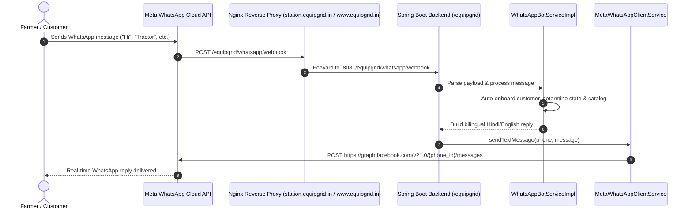

# EquipGrid WhatsApp Meta Cloud API — Complete End-to-End Setup Guide

This guide documents the complete end-to-end lifecycle of the WhatsApp Business Cloud API integration for EquipGrid: from initial Meta account creation, Sandbox configuration, Webhook verification, App publication, WABA subscription, to production company deployment.

---

## Architecture Overview



---

## Phase 1: Meta Developer Account & App Creation

1. Go to [developers.facebook.com](https://developers.facebook.com/) and log in with your Facebook account.
2. Click **My Apps** ➔ **Create App**.
3. Select **Other** (or **Business**) as the app type and click **Next**.
4. Select **Business** as the app use case.
5. Provide:
   - **App Name**: `EquipGrid Station` (or `EquipGrid Power`)
   - **App Contact Email**: Your admin email
   - **Business Portfolio**: Select your Business Account (or let Meta create a default test portfolio).
6. Click **Create app**.
7. In the App Dashboard, locate **WhatsApp** under "Add products to your app" and click **Set up** (or **Connect with customers through WhatsApp**).

---

## Phase 2: Backend Configuration & Environment Variables

The backend accepts Meta credentials dynamically via environment variables so secrets are never hardcoded.

### Key Configuration Variables

| Variable | Description | Example / Default |
|---|---|---|
| `META_PHONE_NUMBER_ID` | Phone Number ID from Meta API Setup | `****************` |
| `META_BUSINESS_ACCOUNT_ID` | WhatsApp Business Account (WABA) ID | `****************` |
| `META_ACCESS_TOKEN` | Temporary Sandbox or Permanent System User Token | `****************` |
| `META_VERIFY_TOKEN` | Secret string you create for Webhook handshake | `****************` |
| `META_APP_SECRET` | App Secret from Meta App Settings ➔ Basic | `****************` |
| `META_API_VERSION` | Graph API version | `v21.0` (or `v22.0`) |
| `META_VERIFY_SIGNATURE` | Whether to enforce HMAC-SHA256 signature check | `false` (dev) / `true` (prod) |

### How to Generate a Permanent Access Token (Never Expires)

By default, the token on the **API Setup** page is a temporary sandbox token that **expires in 24 hours**. 
To get a **Permanent Access Token** that never expires (recommended for both sandbox and production):

#### Step 1: Open Meta Business Settings
1. Go to [business.facebook.com/settings](https://business.facebook.com/settings/).
2. Select your Business Portfolio (e.g., `EquipGrid`).

#### Step 2: Create a System User
1. In the left navigation menu, go to **Users** ➔ **System users**.
2. Click **Add** (or **Create System User**).
3. Fill in:
   - **System Username**: `equipgrid-backend-bot`
   - **System User Role**: Select **Admin** (required to manage messaging assets).
4. Click **Create system user**.

#### Step 3: Assign Assets to the System User
1. Click on your newly created system user (`equipgrid-backend-bot`).
2. Click the **Add Assets** button.
3. Assign the following two assets:
   - **Apps**: Select your app (`EquipGrid Station`). Toggle **Full control** (Manage app) to **ON**.
   - **WhatsApp Accounts**: Select your WhatsApp Business Account (`1795175008399502`). Toggle **Full control** (Manage WhatsApp account) to **ON**.
4. Click **Save Changes**.

#### Step 4: Generate the Permanent Token
1. With `equipgrid-backend-bot` selected, click the **Generate new token** button.
2. In the popup window:
   - **Select App**: Choose your app (`EquipGrid Station`).
   - **Token Expiration**: Choose **Never** (Permanent).
   - **Available Permissions**: Search and check these two mandatory permissions:
     - `whatsapp_business_messaging` (Allows sending and receiving WhatsApp messages)
     - `whatsapp_business_management` (Allows managing WhatsApp accounts and webhooks)
3. Click **Generate Token**.
4. **Copy the token immediately**: Meta will only display this token once! (It starts with `EAAG...`).

---

### Setting in Server Environment (`.env.prod` on EC2)

Add these to `/opt/equipgrid/config/.env.prod`:
```ini
META_PHONE_NUMBER_ID=***************
META_BUSINESS_ACCOUNT_ID=****************
META_ACCESS_TOKEN=****************
META_VERIFY_TOKEN=****************
META_APP_SECRET=****************
META_API_VERSION=v21.0
META_VERIFY_SIGNATURE=false
```

Restart backend:
```bash
docker compose -f docker-compose.prod.yml restart power-backend
```

---

## Phase 3: Webhook Handshake & Verification

Meta performs an initial `GET` handshake request to ensure your server owns the callback URL.

### 1. Verification Endpoint
- **URL**: `https://www.equipgrid.in/equipgrid/whatsapp/webhook`
- **Controller**: `WhatsAppWebhookController.java` (`verifyWebhook` method)
- **Parameters sent by Meta**:
  - `hub.mode=subscribe`
  - `hub.verify_token=<your_configured_token>`
  - `hub.challenge=<random_string>`
- **Backend response**: Echoes `hub.challenge` with `HTTP 200 OK`.

### 2. Configure in Meta Developer Portal
1. In Meta Dashboard, go to **WhatsApp** ➔ **Configuration** (or **Use cases ➔ Customize ➔ Step 2. Production setup**).
2. Under **Configure Webhooks**:
   - **Callback URL**: `https://www.equipgrid.in/equipgrid/whatsapp/webhook`
   - **Verify token**: `eq_whk_9f8a3c2e7b1d4e6a8c0f5b2d7e1a3c5f`
3. Click **Verify and save**.
4. Meta will immediately hit your server. A green checkmark will appear confirming verification.

---

## Phase 4: Subscribing to Webhook Event Fields

Passing the verify token only validates the URL — it does **not** subscribe to incoming events.

1. Under the **Webhook fields** table on the same Configuration page:
2. Find the row named **`messages`**.
3. Toggle the switch to **Subscribed** (shows blue).
4. *(Optional)* Subscribe to `message_template_status_update` if tracking template delivery.

---

## Phase 5: Publishing the Meta App (Critical Requirement!)

### The Trap:
While your Meta App is in **"Unpublished"** (Development) mode, Meta will show this warning:
> ⚠️ *"Apps will only be able to receive test webhooks sent from the app dashboard while the app is unpublished. No production data, including from app admins, developers or testers, will be delivered unless the app has been published."*

If unpublished, **Meta will drop real incoming WhatsApp messages** and only process simulated button clicks from the dashboard.

### Steps to Publish:
1. In the left sidebar, click **App settings** ➔ **Basic** (or click the **[Publish your app]** link).
2. Fill in the required fields:
   - **Privacy Policy URL**: `https://www.equipgrid.in` (or your privacy policy page)
   - **Category**: Business / Productivity / Utilities
3. Click **Save changes**.
4. In the left sidebar, click **Publish** (or toggle the mode from **Development** to **Live**).
5. Confirm. The badge next to your app name will now say **`Published`** in green/gray.

---

## Phase 6: Subscribing the WABA to the App (The Final Missing Link!)

### Why this step is required:
Even after the Webhook is verified and `messages` is subscribed, the **WhatsApp Business Account (WABA)** itself is a separate entity from the Facebook App. Until the WABA is explicitly subscribed to your App ID via Meta's Graph API, Meta's messaging engine will receive incoming messages in its internal queue (visible in "Check test webhooks") but will **never push them to your server's callback URL**.

### How to Subscribe the WABA:

#### Method A: Using Meta Graph API Explorer (Fastest)
1. In the top navigation bar, click **Tools** ➔ **Graph API Explorer** (or go to `https://developers.facebook.com/tools/explorer/`).
2. Top right:
   - **Meta App**: Select `EquipGrid Station`.
   - **User or Page**: Select your App Token or User Token with `whatsapp_business_messaging` permission.
3. In the query box:
   - Change the HTTP method from **`GET`** to **`POST`**.
   - Enter your WABA ID followed by `/subscribed_apps`:
     ```text
     {WABA_ID}/subscribed_apps
     ```
     *(Example: `*****************/subscribed_apps`)*
4. Click **Submit**.
5. Meta will respond with:
   ```json
   {
     "success": true
   }
   ```

#### Method B: Using `curl` from Terminal
```bash
curl -i -X POST "https://graph.facebook.com/v21.0/<YOUR_WABA_ID>/subscribed_apps" \
  -H "Authorization: Bearer <YOUR_META_ACCESS_TOKEN>"
```

Once this returns `{"success": true}`, Meta immediately begins routing all live WhatsApp messages to your server!

---

## Phase 7: Sandbox Testing Flow

In Sandbox mode (test phone numbers):

1. Go to **WhatsApp** ➔ **API Setup** (or **Step 1. Try it out**).
2. Under **"To"** (Recipient phone number), click **Manage phone number list** and add your personal WhatsApp number.
3. Complete the 6-digit SMS/WhatsApp OTP verification.
4. Under **Step 2: Send and receive messages**, click **"Send message"** to send the default `hello_world` or order confirmation template.
   - *Why?* Meta requires initiating a template message first to open the **24-hour customer service window**.
5. Once received on your phone, reply with **`Hi`** or **`Tractor`**.
6. The webhook will fire immediately, hitting:
   ```
   POST /equipgrid/whatsapp/webhook
   ```
7. Your EquipGrid bot will process the message and deliver the bilingual catalog response back to your WhatsApp!

---

## Phase 8: Moving to Production (Real Company Phone Number)

When EquipGrid registers as a legal entity and you acquire a dedicated business phone number:

### 1. Business Verification
- In Meta Business Settings ➔ **Business Info**, upload company registration docs (GSTIN, Incorporation Certificate, Utility bill).
- Verification typically takes 1–3 business days.

### 2. Generate Permanent System User Access Token
Temporary sandbox tokens expire after 24 hours. Production requires a **Permanent System User Token**:
1. Go to [business.facebook.com/settings](https://business.facebook.com/settings/) ➔ **System Users**.
2. Click **Add**, name it `EquipGrid-Bot-System-User`, set role to **Admin**.
3. Under **Assigned Assets**, assign:
   - Your App (`EquipGrid Station`) with **Full Control**.
   - Your WhatsApp Account with **Full Control**.
4. Click **Generate New Token**:
   - Expiration: **Never**.
   - Permissions: Check `whatsapp_business_messaging` and `whatsapp_business_management`.
5. Copy the generated permanent token (`EAAG...`).

### 3. Add Real Phone Number
1. Under Meta WhatsApp Manager ➔ **Phone Numbers**, click **Add Phone Number**.
2. Enter your official EquipGrid business number (e.g. +91 99846XXXXX).
   - *Note:* This number cannot be registered on standard personal/business WhatsApp app on any phone.
3. Verify via SMS OTP or Voice Call.
4. Copy the new **Phone Number ID**.

### 4. Update Server Configuration
Update `/opt/equipgrid/config/.env.prod`:
```ini
META_PHONE_NUMBER_ID=<NEW_PERMANENT_PHONE_NUMBER_ID>
META_ACCESS_TOKEN=<NEW_PERMANENT_SYSTEM_USER_TOKEN>
```
Restart backend:
```bash
docker compose -f docker-compose.prod.yml restart power-backend
```

---

## Troubleshooting & Debugging Commands

### Monitor Real-Time Inbound Webhooks (Backend)
```bash
docker compose -f docker-compose.prod.yml logs -f power-backend
```

### Inspect Nginx Access / Routing Logs
```bash
docker compose -f docker-compose.prod.yml logs --tail=50 station-frontend
```

### Common Error Codes

| Code / Message | Root Cause | Fix |
|---|---|---|
| `(#131030) Recipient phone number not in allowed list` | Sandbox mode: Outbound reply attempted to a number not in your "To" whitelist. | Add recipient number to whitelist in API Setup or test from verified number. |
| `401 Unauthorized / Error validating access token` | Temporary 24-hr sandbox token expired. | Refresh access token in Meta API Setup and update `META_ACCESS_TOKEN` in `.env.prod`. |
| Double checkmarks on WhatsApp, but zero server logs | WABA is not subscribed to the App. | Run `POST /{WABA_ID}/subscribed_apps` via Graph API Explorer. |
| Yellow banner: *"Apps will only be able to receive test webhooks..."* | Meta App is Unpublished (Development mode). | Add Privacy Policy URL in App Settings and click **Publish**. |
| `403 Forbidden: Invalid or missing X-Hub-Signature-256` | Payload signature mismatch. | Ensure `META_VERIFY_SIGNATURE=false` in dev or `META_APP_SECRET` matches Meta App Secret in prod. |
